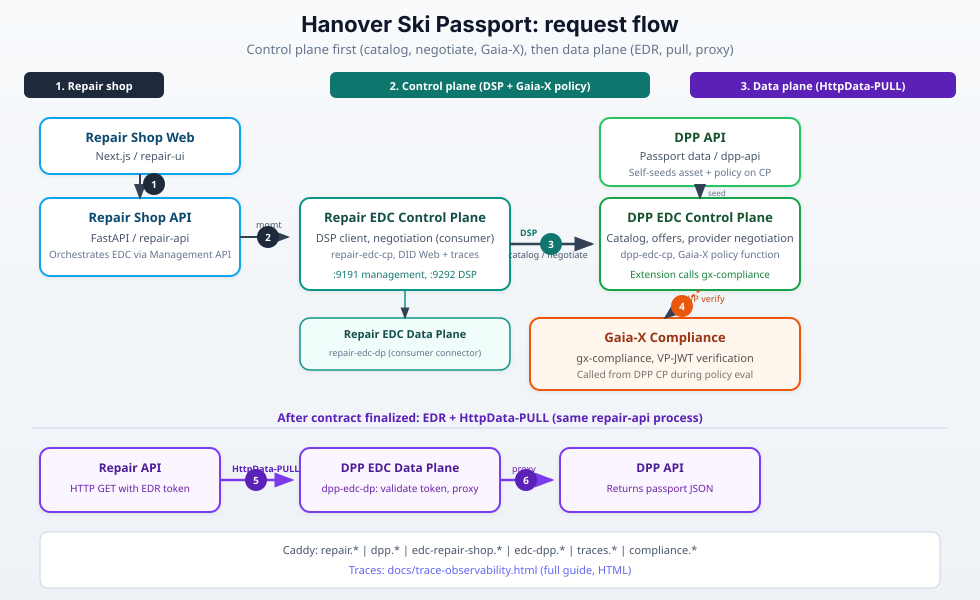
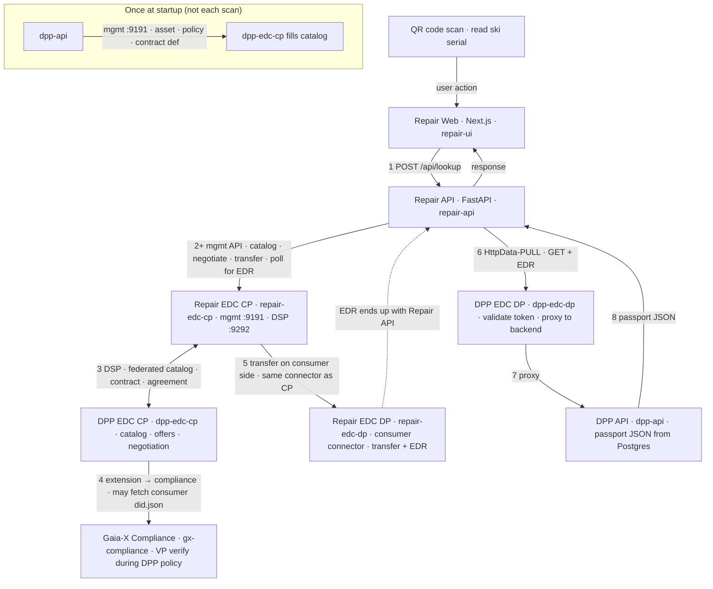
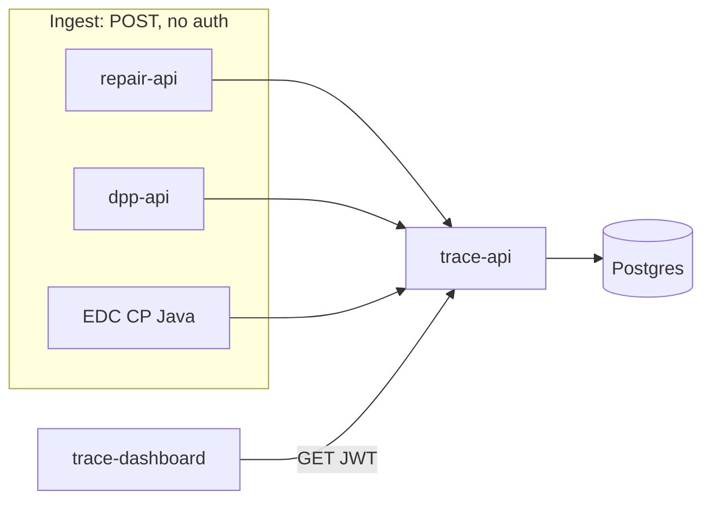

# Hanover Ski Passport Demonstrator

A **federated Digital Product Passport (DPP)** demo: a **Repair Shop** scans a ski QR code and retrieves passport data from a **DPP provider** (Digital Ski Passport). Cross-participant access is **not** done by sharing one API key or one monolithic connector. Each side runs its own **FastAPI backend**, its own **EDC Control Plane** and **EDC Data Plane**, and trust is enforced with **Gaia-X** (verifiable presentations to a compliance service) during **Eclipse EDC** contract negotiation.

## High-level architecture

Each participant has a dedicated **participant id** (`repair_shop`, `dpp`), its own **REST API**, and its own **connector pair** (control plane + data plane). The Repair Shop also has a **Next.js** web app. The DPP side is API-first in routing (no public DPP web UI in the default Caddy config). **Trace API** and **Trace Dashboard** are documented in depth in [docs/trace-observability.html](docs/trace-observability.html) (open the HTML file in a browser).



The diagram uses **numbered steps**: (1) browser to Repair API, (2) Repair API to **Repair EDC CP** via management API, (3) **DSP** between **Repair CP** and **DPP CP** (catalog and negotiation), (4) **DPP CP** to **Gaia-X compliance** (VP verification during policy evaluation). **Repair EDC DP** sits under the consumer CP (connector registration). After the contract is finalized, the **data plane** path (5–6): Repair API performs **HttpData-PULL** with the **EDR** token to **DPP EDC DP**, which **proxies** to **DPP API** for passport JSON. Narrative step-by-step: [docs/SUMMARY.md](docs/SUMMARY.md); services and extensions: [docs/ARCHITECTURE.md](docs/ARCHITECTURE.md).

### Flow overview

The sequence below matches the **implemented call path** described in [docs/trace-observability.html](docs/trace-observability.html) (section *How it works today*). Read the diagram **top to bottom**: it starts at the **QR scan**, moves through **Repair Web** and **Repair API**, then the **Repair** and **DPP** EDC control planes talking over **DSP**, **Gaia-X** on the provider side, the **Repair** data plane for transfer/EDR, and finally **HttpData-PULL** to the **DPP** data plane and **DPP API**. The **GET** that fetches passport bytes runs in **repair-api** using the **EDR** from the consumer connector.

**Local preview:** the built-in Markdown preview does not render Mermaid. Install **[Markdown Preview Mermaid Support](https://marketplace.visualstudio.com/items?itemName=bierner.markdown-mermaid)** (extension ID `bierner.markdown-mermaid`), then reopen the preview. **GitHub** renders these blocks without an extension. The architecture **SVG** above stays useful as a static figure alongside the diagrams below.

**Passport lookup (one QR scan)** — linear story; **Repair API** keeps calling **Repair EDC CP** until catalog, negotiation, transfer, and **EDR** are done, then performs the **GET** to **DPP EDC DP**.



**Trace observability** (orthogonal to the passport HTTP path): emitters POST events to **trace-api**; the dashboard reads them with JWT. A single lookup shares one `trace_id`; EDC extensions correlate connector spans by resolving the latest **repair_api** event.



| Layer | Services (docker-compose) | Notes |
|-------|---------------------------|--------|
| Edge | `caddy` | Subdomain routing to APIs and UIs |
| DPP app | `dpp-api` | Passport data; **self-seeds** EDC asset/policy on startup |
| DPP EDC | `dpp-edc-cp`, `dpp-edc-dp` | Provider connector; Gaia-X + DID Web extensions |
| Repair app | `repair-api`, `repair-ui` | Orchestrates EDC flow; Next.js UI |
| Repair EDC | `repair-edc-cp`, `repair-edc-dp` | Consumer connector |
| Trust | `gx-compliance`, `memgraph` | VP verification during negotiation |
| Trace | `trace-api`, `trace-dashboard-ui` | Event ingestion and dashboard |
| Database | Supabase Postgres (external network) | Shared DB for demo; apps are participant-scoped |

**12 containers** in the main compose file, plus Postgres from the Supabase stack. A larger **legacy** multi-participant scenario (vendor, vaults, service, bridge, etc.) lives in [docker-compose.legacy.yml](docker-compose.legacy.yml); see [docs/ARCHITECTURE.md](docs/ARCHITECTURE.md#deprecated--legacy-services-docker-composelegacyyml).

## What this demonstrates

- **EDC**: federated catalog, contract negotiation, and controlled data transfer (e.g. HttpData-PULL with EDR).
- **Gaia-X**: policy-time compliance checks inside the **DPP control plane** via the **gaiax-auth-extension** (not a separate “bridge” in the core flow).
- **DID / identity**: **did-web-extension** serves `/.well-known/did.json` (via Caddy rewrite) for connector identities.

Conceptual background on global DPP vs lifecycle data: [docs/DPP-WORKFLOW.md](docs/DPP-WORKFLOW.md) (mix of target architecture and demo notes).

## Prerequisites

- **Docker** and **Docker Compose v2**
- **Supabase** (local stack in-repo or external): Postgres on network `supabase_default`
- For a public deployment: **Caddy** on the host (e.g. wildcard TLS) proxying to Docker Caddy **8100**
- **OpenSSL** for Gaia-X signing keys

## Setup

### 1. Environment

```bash
cp env.fixed .env
# or: cp .env.example .env
```

Set at least `POSTGRES_PASSWORD`, `JWT_SECRET`, and Supabase-related variables if you use local Supabase. See `.env.example` for descriptions.

Default demo users (overridable via `APP_USERS` per service):

| Area | Username | Password |
|------|----------|----------|
| Repair Shop API / UI | `demo` | `demo` |
| DPP API | `demo` or `dpp` | per `DPP_USERS` |
| Trace | `demo` | `demo` |

### 2. Gaia-X keys

```bash
mkdir -p certs
openssl req -x509 -newkey rsa:2048 -keyout certs/gaiax-key.pem \
  -out certs/gaiax-cert.pem -days 3650 -nodes \
  -subj "/CN=Hanover Demonstrator Gaia-X/O=Demo/C=DE"
openssl pkcs8 -topk8 -inform PEM -outform PEM \
  -in certs/gaiax-key.pem -out certs/gaiax-key-pkcs8.pem -nocrypt
```

`certs/` is gitignored.

### 3. Local Supabase (optional)

```bash
cp supabase/.env.example supabase/.env
# set POSTGRES_PASSWORD; then:
./scripts/start-local-supabase.sh
```

In root `.env`, set `POSTGRES_HOST=supabase-db`, the same `POSTGRES_PASSWORD` as in `supabase/.env`, and `SUPABASE_URL` / keys so app containers can reach Kong (see `.env.example`).

### 4. Database migrations

```bash
docker exec -i supabase-db psql -U postgres -d postgres \
  < supabase/migrations/001_initial_schema.sql
docker exec -i supabase-db psql -U postgres -d postgres \
  < supabase/migrations/002_passat_schema.sql
```

### 5. Vendor sources for builds

The EDC image and gx-compliance service expect clones under `vendor/`:

```bash
mkdir -p vendor && cd vendor
git clone https://gitlab.com/gaia-x/lab/compliance/gx-compliance.git
git clone https://github.com/eclipse-edc/Template-Basic.git
cd ..
```

`vendor/` is not committed. The **Connector** and **MinimumViableDataspace** repos are only needed for the legacy stack or local experiments.

### 6. Build and run

```bash
docker compose build
docker compose up -d
```

There is **no** separate “seed all EDC connectors via bridge” step for this stack: the **DPP API** seeds its own connector when `EDC_SEED_ENABLED` is true (default).

### 7. Host Caddy (production-style)

Point `*.<DOMAIN>` at your Docker Caddy listener (e.g. `127.0.0.1:8100`). Match hostnames in [caddy/Caddyfile](caddy/Caddyfile) or parameterize for your domain.

## Verify

With your domain or `localhost:8100` mapped to the same routes:

| What | Typical URL pattern |
|------|---------------------|
| Repair Shop UI | `https://repair.<DOMAIN>/` |
| Repair API | `https://repair.<DOMAIN>/api/` |
| DPP API | `https://dpp.<DOMAIN>/api/` |
| Trace Dashboard | `https://traces.<DOMAIN>/` |
| Gaia-X compliance API docs | `https://compliance.<DOMAIN>/docs` |
| EDC (DPP / Repair) | `edc-dpp.<DOMAIN>`, `edc-repair-shop.<DOMAIN>` |

## Project structure (core)

```
hanover-demonstrator/
  docker-compose.yml          # Repair + DPP + EDC + trace + compliance (12 services)
  docker-compose.legacy.yml   # Optional: vendor, vaults, bridge, extra EDCs
  caddy/Caddyfile             # Internal routing
  backend/                    # FastAPI: dpp_api, repair_api, trace_api (+ legacy apps in code)
  frontend/                   # Next.js: repair, trace-dashboard (+ legacy apps)
  edc/                        # Dockerfiles; builds from vendor/Template-Basic + extensions
  docs/                       # Architecture, reports, plans, tutorials
  supabase/migrations/        # SQL schemas
```

## Documentation index

| Document | Purpose |
|----------|---------|
| [docs/ARCHITECTURE.md](docs/ARCHITECTURE.md) | Service list, routing, EDC extensions, legacy compose |
| [docs/SUMMARY.md](docs/SUMMARY.md) | End-to-end trace of the Repair lookup flow |
| [docs/DPP-WORKFLOW.md](docs/DPP-WORKFLOW.md) | DPP concepts; partly historical wording for multi-app demo |
| [docs/IMPLEMENTATION_PLAN.md](docs/IMPLEMENTATION_PLAN.md) | Original build plan (historical; diagram superseded by this README) |
| [docs/REPORT.md](docs/REPORT.md) | Implementation phases completed |
| [docs/TODO.md](docs/TODO.md) | Follow-ups and legacy backlog |
| [docs/TUTORIAL-E2E.md](docs/TUTORIAL-E2E.md) | **Legacy** vendor/vault/service UI tutorial |
| [docs/MANUAL_TEST.md](docs/MANUAL_TEST.md) | Manual test notes |
| [docs/trace-observability.html](docs/trace-observability.html) | Trace pipeline, schema, API, event catalog (HTML) |
| [e2e/README.md](e2e/README.md) | Playwright tests (domains default to legacy apps) |

## Development

**Frontend (Repair app):**

```bash
cd frontend
pnpm install
pnpm --filter repair dev
```

**Backend (Repair API):**

```bash
cd backend
python -m venv .venv && source .venv/bin/activate
pip install -r requirements.txt
APP_NAME=repair uvicorn run:app --reload --port 8000
```

Legacy single-app commands (vendor, admin, etc.) still work when those packages exist and `APP_NAME` matches [backend/run.py](backend/run.py).

## License / attribution

Built for demonstration of Gaia-X and Eclipse EDC integration; see component repos for their licenses.
